<div align="center">

<a href="https://victorsalmeron.dev/dragon-fall/">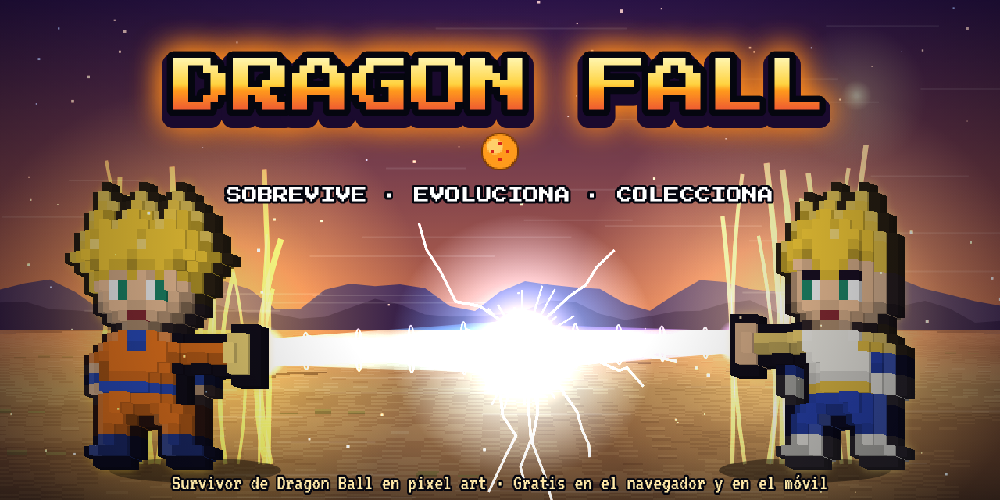</a>

# 🐉 DRAGON FALL

### Un *survivor* de Dragon Ball en *pixel art*.<br>Gratis, en el navegador y en el móvil. Sin descargas ni registro.

<a href="https://victorsalmeron.dev/dragon-fall/"></a>


**110 guerreros · 48 transformaciones · 10 sagas · 21 técnicas con evolución · 154 cartas coleccionables**

</div>

---

<div align="center">

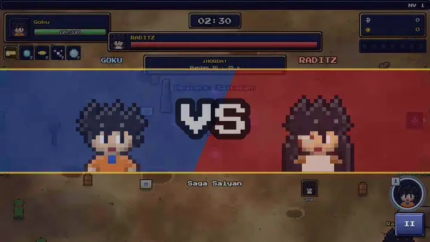

*Goku se transforma en Super Saiyan en plena horda y barre la pantalla con su Kamehameha.*

</div>

## 💥 Aguanta. Sube de nivel. Transfórmate.

Llegan los Saibaman. Luego los soldados de Freezer, los Cell Jr., los esbirros de Babidi y los guerreros de los otros universos. **Oleadas enormes de enemigos**, y tú solo tienes que moverte: tus ataques salen solos.

Recoge ki, sube de nivel y elige mejoras hasta montar tu combinación definitiva. Junta un ataque al máximo con su pasiva para **evolucionarlo** (Kamehameha + Kaio-ken = **Kamehameha x10**). Llega al nivel justo y **transfórmate**: Goku pasa de Super Saiyan a SSJ3, SSJ Blue y **Ultra Instinto**.

Reúne las **7 Bolas de Dragón** y Shenron te concederá un deseo. Y si el jefe final se te resiste, pulsa **1** y suelta tu técnica especial.

<table>
<tr>
<td width="50%" valign="top">

### ⚡ Cada guerrero, su técnica
**110 técnicas especiales distintas**: el Final Flash de Vegeta, el Taiyoken de Krilin, la Bola de la Muerte de Freezer, el Hakai de Beerus, el «¡Conviértete en caramelo!» de Buu o el «¡Soy el campeón!» de Mr. Satan.

</td>
<td width="50%" valign="top">

### 🤝 Fusiones
Lleva un **compañero** que lucha a tu lado. Si es la pareja correcta, llena el medidor y pulsa **2**: **Gogeta**, **Gotenks** o **Kefla** durante 25 segundos.

</td>
</tr>
<tr>
<td valign="top">

### 🔥 Dificultad a tu medida
**Normal, Difícil y Pesadilla**, con más zenis cuanto más duro. Y para los valientes, **∞ Supervivencia**: sin final, con jefes que vuelven una y otra vez.

</td>
<td valign="top">

### 🎲 Partidas que nunca se repiten
Hordas sorpresa, cápsulas que defender, un **Torneo de Artes Marciales** en mitad del mapa y la **Luna llena**, con un Gran Mono suelto y más poder para los Saiyan.

</td>
</tr>
</table>

## 🧬 110 guerreros de todo Dragon Ball

<div align="center">
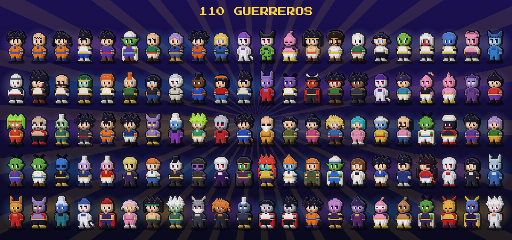
</div>

Del **Goku niño, el Maestro Roshi y Tao Pai Pai** de Dragon Ball a **Broly, Janemba y Bojack** de las películas, los **Super Saiyan 4 y los Dragones Oscuros** de GT, **Champa, Vados, Moro, Granolah y los Gamma** de Super y **Gomah y los Majin** de Daima. Cada uno tiene su ataque inicial, su técnica especial y sus estadísticas, y muchos se transforman durante la partida (Goku llega al **Super Saiyan 4** en GT y en Daima).

| Rareza | Guerreros | Ejemplos |
|:--|:--:|:--|
| 🟡 **Legendario** | 16 | Gogeta SSJ4, Janemba, Omega Shenron, Champa, Gomah |
| 🟣 **Épico** | 37 | Goku, Vegeta, Piccolo Daimaō, Bojack, Baby, Moro |
| 🔵 **Raro** | 37 | Maestro Roshi, Gohan (niño), Tapion, Gamma 1, Majin Kuu |
| ⚪ **Común** | 20 | Goku (niño), Bulma, Chi-Chi, Yajirobe, Mr. Satán |

## 🌍 10 sagas, 40 jefes

| Saga | Escenario | Jefe final |
|:--|:--|:--|
| 🐉 **Dragon Ball** | Bosque de la Torre Karin | Piccolo Daimaō |
| 🪨 **Saga Saiyan** | Páramo rocoso | Vegeta Ozaru |
| 🟢 **Saga de Namek** | Planeta Namek | Freezer (forma final) |
| 🏟️ **Juegos de Cell** | Ring de Cell | Cell Perfecto |
| 🎬 **Películas de Dragon Ball Z** | Otro Mundo | Super Janemba |
| 🩷 **Saga de Majin Buu** | Planeta Supremo | Kid Buu |
| 😈 **Dragon Ball Daima** | Reino Demoníaco | Gomah |
| 🌌 **Torneo del Poder** | Mundo del Vacío | Jiren |
| 🦸 **Super: Moro, Granolah y Super Hero** | Base de la nueva Patrulla Roja | Cell Max |
| 🔥 **Dragon Ball GT** | Tierra devastada | Omega Shenron |

Cada saga dura 10 minutos, tiene su música y sus enemigos, 3 jefes intermedios y un jefe final. Dragon Ball y la Saga Saiyan están abiertas desde el principio; las demás se desbloquean completando la anterior de su época.

## 🗺️ Un mapa lleno de secretos

<div align="center">
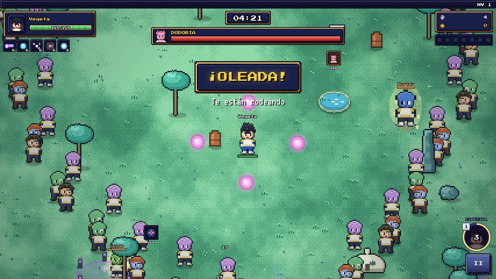 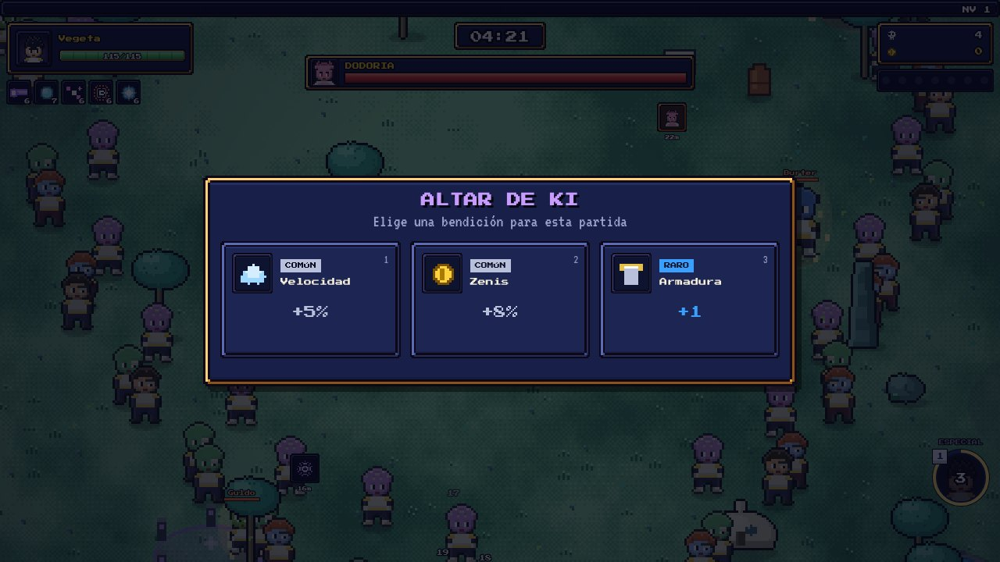
</div>

- 📦 **Cajas y jarrones** que se rompen y sueltan comida, zenis o experiencia.
- 🍖 **Comida** que cura, y **fuentes curativas**: cuando vas mal de vida, una flecha te señala la más cercana.
- ✨ **Altares de ki**: cárgalos y elige una bendición para la partida, de común a legendaria.
- 💰 **Cofres** que se abren con los zenis que ganas.
- 😈 **Estatuas de Babidi**: actívalas si te atreves. Más enemigos y más duros, pero más recompensa.

## 🎰 Cajas con ruleta

<div align="center">
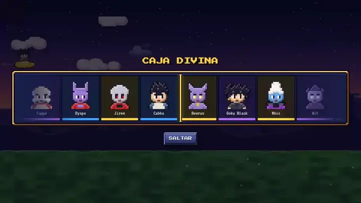
</div>

**14 cajas temáticas** (Dragon Ball, Guerreros Z, Imperio, Patrulla Roja, Majin, Películas, GT, Super, Daima, Saiyan, Fusión, Divina…). Ábrelas con una ruleta estilo Counter-Strike: mientras frena se carga un **«Ka… me… ha… me…»** y al pararse suena **«¡HA!»**. Haz clic en una caja para ver todo lo que puede tocar y con qué probabilidad.

La **tienda** también tiene regalo diario con racha, ofertas pensadas **solo para ti** y descuentos que cambian cada día. Todo con zenis del juego: **nunca con dinero real**.

## 🃏 Cartas coleccionables

<div align="center">
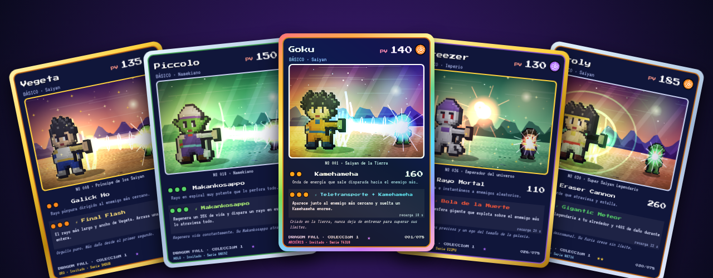
</div>

Cada guerrero y cada transformación que consigues tiene su carta: **154 en total**. En cada una, el guerrero aparece **en 3D** lanzando su técnica contra un enemigo, en el escenario de su saga.

- 🎨 **Dos estilos:** **3D en acción** (el guerrero lanzando su técnica) o **Clásica** (solo el guerrero, con su aura). Se cambia en el álbum o en la propia carta.
- 🌈 **Cuatro acabados:** Normal, Holo, Oro y Arcoíris, con brillo que se mueve al inclinar la carta con el ratón o el dedo.
- 🔢 Cada carta lleva **tu nombre y un número de serie único**.
- ⬇️ **Descárgalas** en imagen (PNG) o en **vídeo animado**.
- 🛍️ **Sobres** que se pagan con zenis, y un **simulador gratis** para abrir todos los que quieras.

<div align="center">
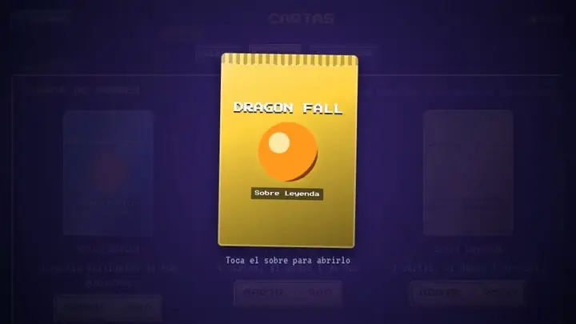
</div>

## 🏆 Siempre hay algo que hacer

- 📋 **3 misiones diarias**, distintas para cada jugador.
- 🎖️ **31 logros** con premios y **títulos** para presumir.
- ⭐ **Nivel de cuenta** con recompensas y un **perfil** con tus estadísticas y tus **horas jugadas**.
- 🥇 **Ranking semanal** de Supervivencia y de bajas. Se reinicia cada lunes.
- 🏛️ **Templo de Kami**: mejoras permanentes para tu guerrero.
- 📖 **Dragonpedia** con todos los guerreros, enemigos y jefes, y cómo conseguir los que te faltan.

<div align="center">
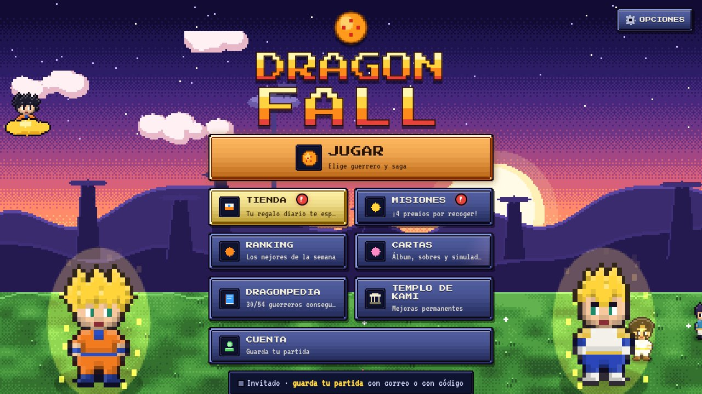 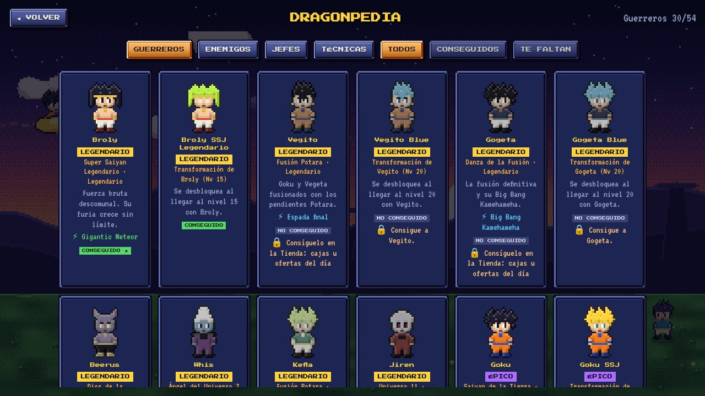
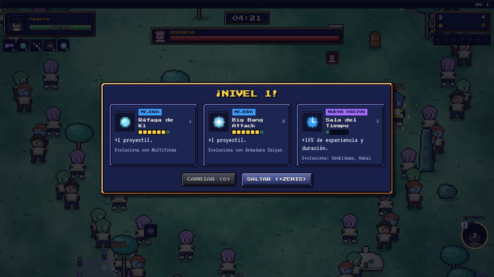
</div>

## 📱 En el bolsillo

<div align="center">
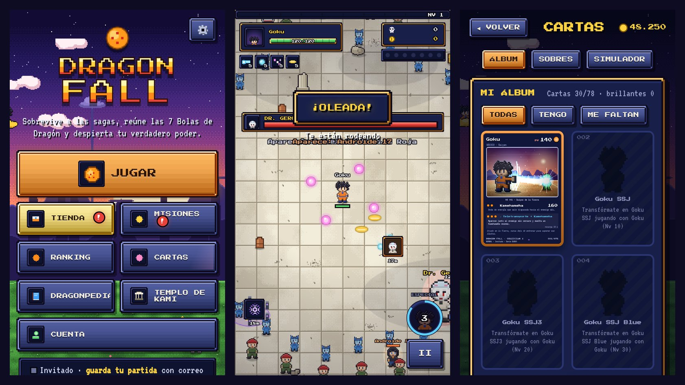
</div>

Se juega igual de bien en el móvil: arrastra el dedo para moverte y toca el botón redondo para lanzar la técnica especial. **Añádelo a la pantalla de inicio** y funciona como una app, incluso **sin conexión**.

## 🎮 Controles

| Acción | ⌨️ Teclado | 📱 Móvil | 🎮 Mando |
|:--|:--|:--|:--|
| Moverse | WASD / flechas | Arrastrar el dedo | Stick o cruceta |
| Técnica especial | **1** (o Espacio, E, Q) | Botón redondo | A |
| Fusión | **2** (o F) | Botón de fusión | X / Y |
| Pausa | Esc / P | Botón `II` | Start |

Los ataques normales se lanzan solos contra el enemigo más cercano.

## 💾 Tu progreso, a salvo

- **Con correo y contraseña (o Google):** se guarda solo en la nube y lo recuperas en cualquier dispositivo.
- **Con código:** un código corto con todo tu progreso. Lo copias y lo pegas en otro navegador.

<div align="center">

---

### ¿A qué esperas? Los Saibaman ya están aquí.

<a href="https://victorsalmeron.dev/dragon-fall/"></a>

**[victorsalmeron.dev/dragon-fall](https://victorsalmeron.dev/dragon-fall/)**

---

</div>

<details>
<summary><b>🛠️ Para desarrolladores: cómo está hecho</b></summary>

<br>

Todo el juego cabe en un solo archivo HTML (HTML, CSS y JavaScript con `<canvas>`). No hay imágenes externas: los sprites, los escenarios, los modelos 3D de las cartas, la música y las voces se generan por código.

- **Código legible:** `src/`. **Juego publicado:** `index.html`, protegido (minificado y ofuscado).
- **Traducciones:** `src/2c_i18n_data.js` (cada texto en castellano con su versión en català y English).
- **Cuentas y ranking:** Firebase (Auth y Firestore). Para activarlo, sigue [FIREBASE.md](FIREBASE.md); las reglas están en `firestore.rules`.
- **Imágenes de este README:** `docs/media/`. Son capturas y grabaciones del propio juego.

```bash
npm install
npm run build   # index.html protegido (el que se publica)
npm run dev     # dev.html legible, para probar cambios
```

`npm run build` genera también `manifest.webmanifest` y `sw.js` (instalación y modo sin conexión).

**Publicar:** copia `index.html`, `manifest.webmanifest`, `sw.js` y la carpeta `icons/` a la carpeta `dragon-fall/` de la web (repo `salmeronvictor486-lang.github.io`). También se puede abrir `index.html` con doble clic.

**Protección:** todo el JavaScript va en un bloque cerrado (desde la consola del navegador no se puede tocar la partida ni los zenis) y está ofuscado. Para que nadie vea el código de `src/`, **este repositorio debe ser privado**.

</details>

## ⚠️ Aviso

Fan game **sin ánimo de lucro**: no tiene anuncios, ni pagos, ni donaciones a cambio de ventajas, y así debe seguir para no tener problemas con los dueños de Dragon Ball. Dragon Ball © Bird Studio / Shueisha / Toei Animation. Este proyecto no está afiliado con ellos. Las voces las genera el navegador; no son grabaciones del anime.

<div align="center">

Hecho con ki por **[Víctor Salmerón Gavilán](https://victorsalmeron.dev)** 🐉

</div>
